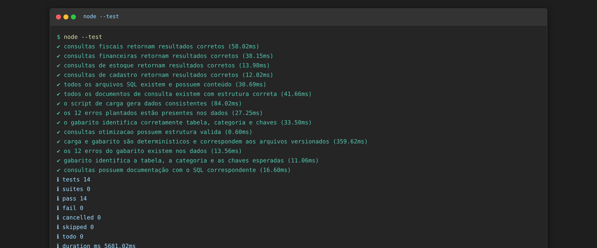
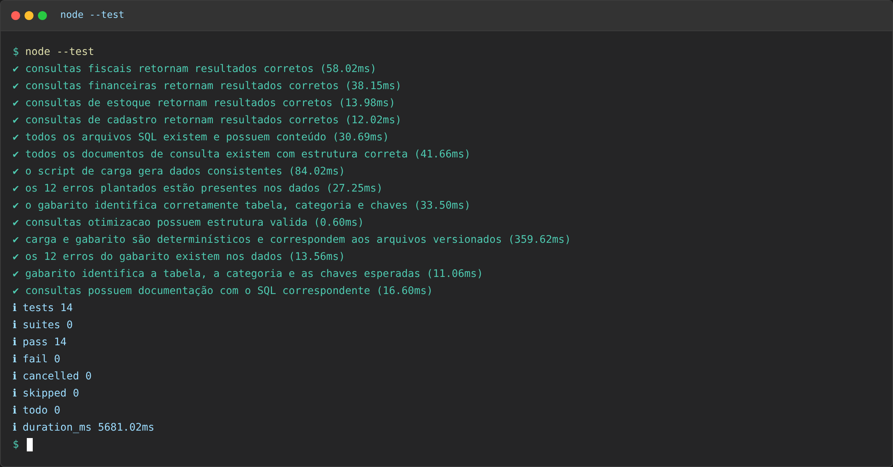
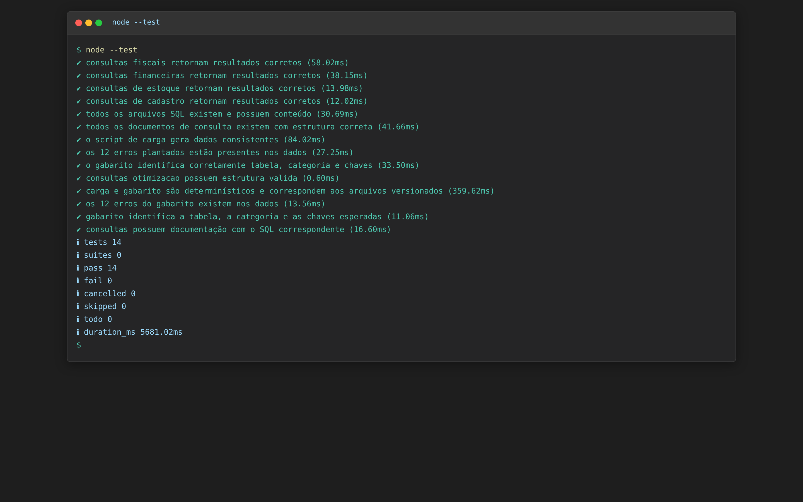
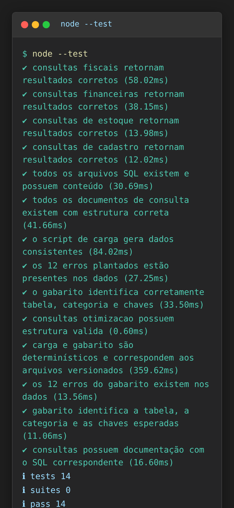

# Consultas SQL para Diagnóstico de ERP

> **Status:** ✅ Concluído - 20 consultas com testes automatizados, documentação e CI configurado.
> **Demonstração:** [Ver no GitHub Pages](https://hey-pablo.github.io/sql-diagnostico-erp/)

Um banco fictício de ERP com 12 erros plantados e 20 consultas T-SQL documentadas que os encontram: nota com total diferente da soma dos itens, numeração com buracos, título duplicado, estoque negativo, cadastro repetido e outros.

## Problema

No suporte a ERP, a causa de uma reclamação quase sempre está nos dados: "a nota não fecha", "sumiu um número", "o título foi cobrado duas vezes". Quem atende precisa de consultas prontas que respondam a essas perguntas, e de um ambiente seguro para treinar sem tocar em dados de cliente.

## Solução

- Um banco com 8 tabelas (clientes, produtos, pedidos, itens, notas, itens de nota, títulos e movimentos de estoque), cerca de 2.400 linhas de dados fictícios e 12 erros plantados, listados em `docs/erros-plantados.json`.
- 20 consultas em 4 categorias (fiscal 6, financeiro 5, estoque 5, cadastro 4), cada uma com um documento que traz a pergunta de negócio, o SQL, o resultado esperado e quando usar.
- 3 pares de consultas "antes e depois" de índice em `consultas/otimizacao/`.
- Técnicas: CTE, funções de janela (`LAG`), `LEFT JOIN ... IS NULL`, `GROUP BY ... HAVING` e faixas de atraso.

Diagrama das tabelas em [`docs/diagrama.md`](docs/diagrama.md).

## Como rodar

Requer Docker. A senha do SQL Server vem de um arquivo `.env` (não versionado):

```bash
cp .env.example .env          # edite e defina MSSQL_SA_PASSWORD (senha forte)
docker compose up -d          # sobe o SQL Server 2022 Developer
./scripts/criar-e-carregar.sh # no Windows: .\scripts\criar-e-carregar.ps1
```

O script cria o banco `ERPDiagnostico`, o schema, os índices e a carga. Se o banco já existir, ele para sem sobrescrever. Depois, abra qualquer consulta de `consultas/` no SSMS, Azure Data Studio ou `sqlcmd` (banco `ERPDiagnostico`) e compare com o resultado esperado em `docs/`.

Testes (Node 20 ou superior, sem banco):

```bash
node --test
```

## Estrutura

```
schema/      tabelas, chaves, restrições e índices
seed/        carga fictícia (gerada)
tools/       gerar-seed.js: gerador determinístico (semente fixa)
consultas/   fiscal, financeiro, estoque, cadastro e otimizacao
docs/        um documento por consulta, diagrama e gabarito dos erros plantados
scripts/     criar-e-carregar (.sh e .ps1)
test/        testes do gerador e do gabarito
docker-compose.yml, .env.example
```

## Decisões técnicas

- **Carga gerada por script com semente fixa**: o mesmo comando produz exatamente os mesmos dados, e o gabarito `erros-plantados.json` nasce junto.
- **Testes sem banco**: conferem que o gerador é determinístico, que os arquivos versionados são iguais ao que o gerador produz e que cada um dos 12 erros existe de fato nos dados.
- **Data de referência fixa** nas consultas de atraso, para o resultado ser reproduzível.
- **Segredo fora do código**: senha em `.env`, com `.env.example` no repositório.
- **Porta só em localhost** (`127.0.0.1:1433`) no `docker-compose.yml`.

## Limitações

- As consultas e os scripts de carga **não foram executados num SQL Server real** (sem Docker na VPS). Os testes automatizados validam:
  - A determinística da geração de dados
  - A correspondência entre arquivos SQL e documentos
  - A presença dos 12 erros plantados nos dados gerados
- Os planos de execução de `consultas/otimizacao/` não foram medidos; com tão poucas linhas, a varredura pode vencer o índice.
- Dados fictícios e pequenos: servem para treino, não para medir desempenho.

## O que testar no PC (Docker e SQL Server)

1. `docker compose up -d` e aguardar o healthcheck ficar saudável (`docker compose ps`).
2. Rodar o script de carga e conferir a mensagem "Banco ERPDiagnostico criado e carregado."
3. Executar cada uma das 20 consultas e comparar com o "Resultado esperado" do documento correspondente.
4. Executar os pares de `consultas/otimizacao/` com o plano de execução real e `STATISTICS IO`.

Qualquer divergência ou erro de sintaxe: abra uma issue com o nome do arquivo e a mensagem.

## Telas

### Execução dos testes



### Terminal de saída



### Tela completa



### Mobile view



## GIF de demonstração

```text
docs/demo.gif
```
Animação mostrando a execução dos testes com a saída completa.

## Onde a IA entrou

O schema, o gerador, as consultas e os documentos foram escritos com assistência de IA e revisados; a execução no SQL Server fica a cargo de quem for usar.

## Próximos passos

Validar tudo no SQL Server, medir os planos de otimização e usar este banco como base do projeto "Pergunte ao ERP" (texto para SQL).